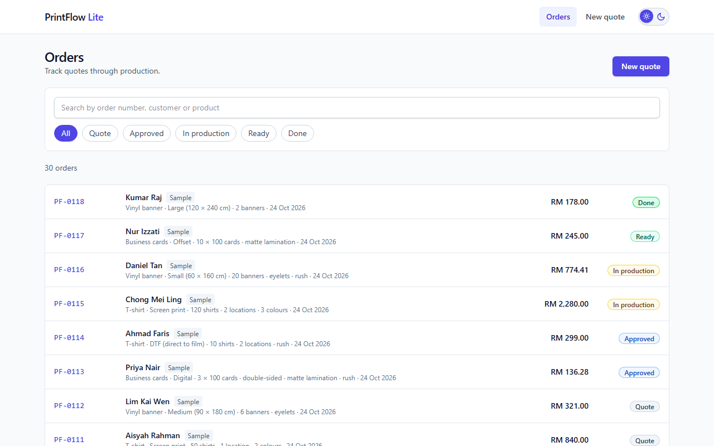
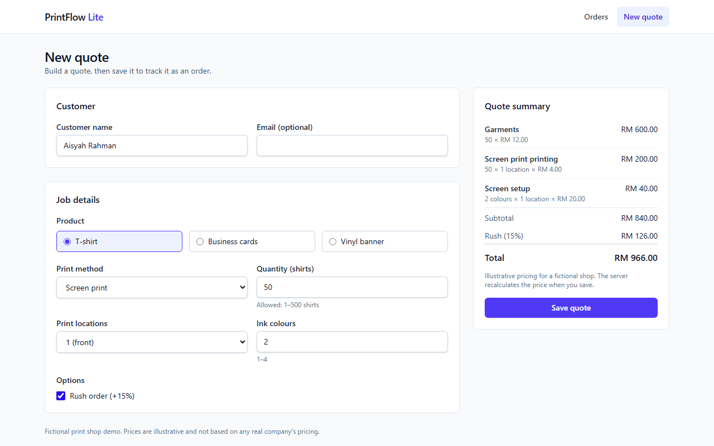
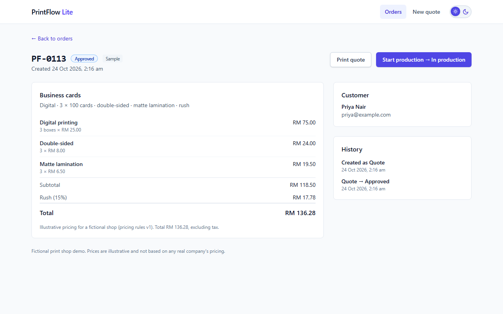

# PrintFlow Lite

[](https://github.com/tai285/printflow-lite/actions/workflows/ci.yml)

A full-stack quote and order tracker for a **fictional** print shop. Build a quote with live, itemised pricing, save it for a customer, and move the order through **Quote → Approved → In production → Ready → Done**.

The whole system (React UI, Express API, PostgreSQL) starts with one command and runs locally in Docker. Pricing rules are illustrative and invented for this project; they are not based on any real company's pricing.



|          New quote with live price           |                    Order detail                    |
| :------------------------------------------: | :------------------------------------------------: |
|  |  |

## Quick start

Requirements: [Docker](https://www.docker.com/) with Compose.

```bash
docker compose up --build
```

Open **http://localhost:3000**. The stack starts PostgreSQL, applies database migrations, loads fictional sample orders into an empty database, and serves the UI and API together.

```bash
docker compose down        # stop (data is kept in a Docker volume)
docker compose down -v     # stop and delete the data
```

## Public demo (free, self-hosted)

```bash
npm run public:up      # starts the stack and a free Cloudflare tunnel, prints a public https URL
npm run public:down    # stop publishing
```

No account, domain or VPS is needed: the Docker stack runs on your machine and a Cloudflare quick tunnel exposes it. Visitor data is wiped hourly and write requests are rate limited. Details, limits, SEO and how to get a stable free address are in [docs/DEPLOYMENT.md](docs/DEPLOYMENT.md).

## Features

- **Quote builder**: T-shirts, business cards and vinyl banners with product-specific options, tiered pricing, setup fees and a rush surcharge. The price updates live and every line is itemised.
- **Server is the price authority**: the browser previews prices with the same shared function, but the API ignores any total the client sends and recalculates it from validated input.
- **Orders**: list with search (number, customer, product) and status filter kept in the URL, detail page with price snapshot and status history, forward-only workflow.
- **Safe concurrency**: two people advancing the same order cannot both succeed. The loser gets a `409` and the UI explains it and refreshes.
- **Validation everywhere**: one set of Zod schemas and business rules used by both the form and the API; field errors are shown next to their inputs.
- **Printable quote**, responsive layout, keyboard and screen-reader friendly (checked with axe in CI).
- **Demo helpers**: load or remove clearly labelled sample orders from the UI.

## Pricing (illustrative)

Money is stored as integer sen. Quantity tiers, setup fees, option prices, a 15% rush surcharge applied once at the end (rounded half-up), and per-unit rounding for banner volume discounts. The full rules and worked examples (which are also test cases) are in [docs/PRODUCT_SPEC.md](docs/PRODUCT_SPEC.md#pricing-rules-illustrative).

## Stack

| Layer    | Choice                                                                      |
| -------- | --------------------------------------------------------------------------- |
| Frontend | React 19, TypeScript, Vite 8, Tailwind CSS 4, React Router, TanStack Query  |
| Backend  | Node 24 running TypeScript directly, Express 5, Zod, Helmet, rate limiting  |
| Database | PostgreSQL 17, Drizzle ORM and SQL migrations                               |
| Testing  | Vitest, Supertest (real PostgreSQL), React Testing Library, Playwright, axe |
| Delivery | Docker (multi-stage image) + Compose, GitHub Actions CI                     |
| Tooling  | oxlint, Prettier                                                            |

Reasons for each choice are in [docs/ARCHITECTURE.md](docs/ARCHITECTURE.md).

## Development

Requirements: Node 24 (`nvm use` reads `.nvmrc`) and Docker.

```bash
cp .env.example .env
docker compose up -d db          # PostgreSQL only
npm install
npm run db:migrate && npm run db:seed
npm run dev                      # web http://localhost:5173 (proxies /api), API http://localhost:3000
```

| Command                                            | What it does                                                  |
| -------------------------------------------------- | ------------------------------------------------------------- |
| `npm run dev`                                      | Vite dev server + API with auto-restart                       |
| `npm test`                                         | Unit and component tests (no database needed)                 |
| `npm run test:int`                                 | API integration tests against real PostgreSQL                 |
| `npm run e2e`                                      | Browser tests against the running Docker stack                |
| `npm run smoke`                                    | Smoke checks against the running stack                        |
| `npm run public:up` / `public:url` / `public:down` | Publish the stack through a free Cloudflare tunnel            |
| `npm run typecheck` / `lint` / `format:check`      | Static checks                                                 |
| `npm run build`                                    | Type-check and build the web app to `dist/web`                |
| `npm run db:generate`                              | Generate a SQL migration after changing `server/db/schema.ts` |
| `npm run db:migrate` / `db:seed`                   | Apply migrations / replace sample orders                      |

`npm run test:int` needs PostgreSQL (`docker compose up -d db`); it creates a separate `printflow_test` database. First-time browser tests need `npx playwright install chromium`.

## API

All errors use the shape `{ "error": { "code", "message", "fields?" } }`.

| Method & path                              | Description                                                      | Success   | Errors                                          |
| ------------------------------------------ | ---------------------------------------------------------------- | --------- | ----------------------------------------------- |
| `GET /api/health`                          | Liveness, database check and build version                       | 200       | 503 if the database is down                     |
| `GET /api/orders?q=&status=`               | List orders, newest first                                        | 200       | 400 unknown status                              |
| `POST /api/orders`                         | Create a quote; the price is computed by the server              | 201       | 400 `VALIDATION_ERROR` with `fields`            |
| `GET /api/orders/:id`                      | One order with status history                                    | 200       | 404                                             |
| `POST /api/orders/:id/transitions`         | Move to the next status: `{ "from": "quote", "to": "approved" }` | 200       | 400, 404, 409 `CONFLICT` / `INVALID_TRANSITION` |
| `POST /api/samples`, `DELETE /api/samples` | Replace / remove the sample orders (real orders untouched)       | 201 / 200 | 429                                             |

```bash
curl -s localhost:3000/api/orders -H 'Content-Type: application/json' -d '{
  "customerName": "Aisyah",
  "input": { "productId": "tshirt", "method": "screen", "quantity": 50,
             "locations": 1, "colours": 2, "rush": false }
}'
```

Write endpoints are rate limited per IP. Request bodies are limited to 10 kB.

## Testing and CI

Layers, what each one catches, and the manual checklist are in [docs/TEST_PLAN.md](docs/TEST_PLAN.md).

GitHub Actions runs on every pull request and push to `main`:

1. **quality**: lint, formatting, type-check, unit and component tests, production build
2. **integration**: API tests against a PostgreSQL service container
3. **stack**: builds the Docker image, boots the full Compose stack, runs the smoke script (including the exact commit SHA) and the Playwright browser tests

## Project layout

```
shared/   pure TypeScript: pricing, validation, status rules (used by server and web)
server/   Express API, Drizzle schema, seed data, integration tests
web/      React app and component tests
e2e/      Playwright tests
drizzle/  generated SQL migrations
scripts/  smoke test, screenshot capture
docs/     spec, architecture, plan, test plan, AI code-review log
```

## Known limitations

- No authentication: the demo is one shared workspace. Anyone who can reach the app can see and change orders.
- Saved quotes cannot be edited and orders cannot be deleted from the UI.
- Prices exclude tax and are fictional.
- Hosting is self-hosted: the public demo is only up while your machine runs it, and its URL changes on restart.

## Documentation

- [Product spec](docs/PRODUCT_SPEC.md): users, scope, stories, pricing rules
- [Architecture](docs/ARCHITECTURE.md): structure, data model, decisions, CI
- [Deployment and SEO](docs/DEPLOYMENT.md): free self-hosting with Cloudflare Tunnel
- [Implementation plan](docs/IMPLEMENTATION_PLAN.md): build checklist
- [Test plan](docs/TEST_PLAN.md): test layers and manual checklist
- [AI code-review log](docs/AI_CODE_REVIEW_LOG.md): how AI-generated code was checked
